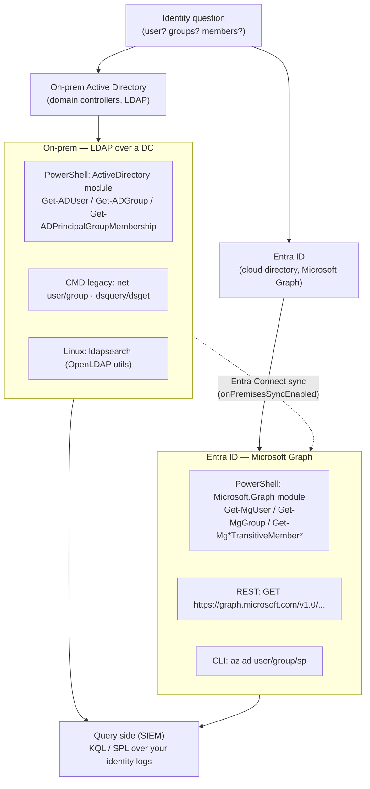

# Identity & Directory Query Cookbook

Recipes for the identity questions you actually ask — *"get me this user and every group they're in"*,
*"find everyone whose name contains `smith`"*, *"who is nested inside Domain Admins?"* — answered in **every place
identity lives**: on-premises **Active Directory** (LDAP) and **Entra ID** (Microsoft Graph), plus the SIEM
**query side** for the same questions on your logs.

For the one-line quick form of these commands see the
[Identity and directory section of the Command Index](command-index.md#identity-and-directory-active-directory-entra-id).
This page is the deeper cookbook: full examples, the direct-vs-nested distinction, and the gotchas that bite.

> These are **read-only lookups**. They do not change the directory. Run them with a least-privilege read account
> (AD: a normal domain user can read most of this; Entra: `Directory.Read.All` / `User.Read.All` / `Group.Read.All`).

## Which plane am I querying?

Pick the tool by where the object lives. A hybrid tenant has objects in both, joined by Entra Connect sync.



**Rule of thumb:** if the account signs in to a domain-joined server or file share, start with **AD**; if it signs in
to Microsoft 365 / Azure / SaaS via Entra, start with **Graph**. Synced accounts appear in both — in Graph they carry
`onPremisesSyncEnabled = true` and are *mastered* on-prem (edit them in AD, not Entra).

## Before you start — modules, connection and permissions

=== "AD module (PowerShell)"

    ```powershell
    # RSAT: Active Directory module (Windows client or server)
    # Windows 10/11: Settings > Optional Features > "RSAT: Active Directory Domain Services..."
    # Server:        Install-WindowsFeature RSAT-AD-PowerShell
    Import-Module ActiveDirectory

    # Target a specific DC and your domain's base DN as needed
    $DC   = 'dc01.corp.example'
    $Base = 'DC=corp,DC=example'
    ```

=== "Microsoft Graph (PowerShell)"

    ```powershell
    # Install once (CurrentUser avoids admin rights)
    Install-Module Microsoft.Graph -Scope CurrentUser

    # Connect with ONLY the read scopes you need (consent prompt on first use)
    Connect-MgGraph -Scopes "User.Read.All","Group.Read.All","Directory.Read.All","AuditLog.Read.All"

    Get-MgContext | Select-Object Account, Scopes   # confirm who/what you are
    ```

=== "ldapsearch (Linux)"

    ```bash
    # Debian/Ubuntu: sudo apt install ldap-utils   |   RHEL: sudo dnf install openldap-clients
    # Simple bind over LDAPS (636). Prefer -Y GSSAPI/Kerberos where available over a bind password.
    BASE="DC=corp,DC=example"
    HOST="ldaps://dc01.corp.example"
    BIND="CN=svc-read,OU=Service,$BASE"
    # ldapsearch -x -H "$HOST" -D "$BIND" -W -b "$BASE" "(objectClass=user)"
    ```

=== "az CLI (Entra)"

    ```bash
    # Azure CLI reads Entra ID via Microsoft Graph under the hood
    az login
    az account show --query user -o json
    ```

## Part A — On-premises Active Directory

### Who am I, and what groups am I in?

=== "PowerShell"

    ```powershell
    whoami /all                                   # SID, groups, privileges for the current token
    Get-ADPrincipalGroupMembership $env:USERNAME | Select-Object Name, GroupCategory, GroupScope
    ```

=== "CMD"

    ```bat
    whoami /groups
    gpresult /r                                   :: resolved groups + applied GPOs
    net user %USERNAME% /domain                   :: "Global Group memberships" lines
    ```

=== "LDAP (Bash)"

    ```bash
    ldapsearch -x -H "$HOST" -b "$BASE" "(sAMAccountName=$USER)" memberOf
    ```

### Look up a single user

=== "PowerShell"

    ```powershell
    # -Properties * is verbose; name the attributes you need for speed
    Get-ADUser jsmith -Properties DisplayName, Mail, Department, Enabled, LastLogonDate, whenCreated
    ```

=== "CMD"

    ```bat
    net user jsmith /domain
    dsquery user -samid jsmith | dsget user -display -email -disabled
    ```

=== "LDAP (Bash)"

    ```bash
    ldapsearch -x -H "$HOST" -b "$BASE" "(sAMAccountName=jsmith)" \
      displayName mail department userAccountControl
    ```

### Find users by **wildcard** name (you only know part of the name)

=== "PowerShell"

    ```powershell
    # -Filter uses PowerShell wildcards with -like; -LDAPFilter uses raw LDAP globbing
    Get-ADUser -Filter "Name -like '*smith*'" -Properties DisplayName, Mail |
        Select-Object Name, DisplayName, Mail
    Get-ADUser -LDAPFilter "(|(cn=*smith*)(displayName=*smith*))" -Properties DisplayName
    ```

=== "CMD"

    ```bat
    dsquery user -name "*smith*"
    ```

=== "LDAP (Bash)"

    ```bash
    ldapsearch -x -H "$HOST" -b "$BASE" "(|(cn=*smith*)(displayName=*smith*))" cn displayName mail
    ```

### A user's **direct** groups vs **all / nested** groups

This is the distinction that trips people up. `memberOf` lists only the groups the user is a **direct** member of.
A user is often an *effective* member of many more through **nested** groups (group A is a member of group B).

=== "PowerShell"

    ```powershell
    # DIRECT groups only (the memberOf attribute)
    (Get-ADUser jsmith -Properties MemberOf).MemberOf

    # ALL groups incl. nested — resolved by the DC (the one you almost always want)
    Get-ADPrincipalGroupMembership jsmith | Select-Object Name, GroupScope | Sort-Object Name
    ```

=== "CMD"

    ```bat
    :: Direct: the "Group" lines
    net user jsmith /domain

    :: Nested/expanded: -expand walks the chain (needs the user's full DN)
    for /f "delims=" %D in ('dsquery user -samid jsmith') do @dsget user %D -memberof -expand
    ```

=== "LDAP (Bash)"

    ```bash
    # DIRECT groups
    ldapsearch -x -H "$HOST" -b "$BASE" "(sAMAccountName=jsmith)" memberOf

    # ALL / NESTED groups — LDAP_MATCHING_RULE_IN_CHAIN (OID 1.2.840.113556.1.4.1941)
    # Give the user's DN; returns every group up the nesting chain.
    ldapsearch -x -H "$HOST" -b "$BASE" \
      "(member:1.2.840.113556.1.4.1941:=CN=John Smith,OU=Users,$BASE)" cn
    ```

### Members of a group (including nested members)

=== "PowerShell"

    ```powershell
    Get-ADGroupMember "Domain Admins"            # direct members
    Get-ADGroupMember "Domain Admins" -Recursive | # includes members of nested groups
        Select-Object Name, SamAccountName, objectClass
    ```

=== "CMD"

    ```bat
    net group "Domain Admins" /domain
    dsquery group -name "Domain Admins" | dsget group -members -expand
    ```

=== "LDAP (Bash)"

    ```bash
    # Everyone effectively in the group (nested), using the IN_CHAIN rule on memberOf
    ldapsearch -x -H "$HOST" -b "$BASE" \
      "(memberOf:1.2.840.113556.1.4.1941:=CN=Domain Admins,CN=Users,$BASE)" sAMAccountName
    ```

### Account state — enabled, disabled, stale, locked

=== "PowerShell"

    ```powershell
    Get-ADUser -Filter 'Enabled -eq $false' -Properties whenChanged            # disabled
    $cut = (Get-Date).AddDays(-90)
    Get-ADUser -Filter 'LastLogonDate -lt $cut -and Enabled -eq $true' `
        -Properties LastLogonDate | Sort-Object LastLogonDate                  # stale (90d)
    Search-ADAccount -LockedOut | Select-Object Name, SamAccountName            # locked out
    Search-ADAccount -AccountExpired                                           # expired
    ```

=== "CMD"

    ```bat
    dsquery user -disabled
    dsquery user -inactive 13           :: inactive >= 13 weeks (~90 days)
    ```

=== "LDAP (Bash)"

    ```bash
    # Disabled = userAccountControl bit 2 set (LDAP_MATCHING_RULE_BIT_AND, OID ...803)
    ldapsearch -x -H "$HOST" -b "$BASE" \
      "(&(objectClass=user)(userAccountControl:1.2.840.113556.1.4.803:=2))" sAMAccountName
    ```

### Service accounts and Service Principal Names (SPNs)

=== "PowerShell"

    ```powershell
    # Group-managed service accounts
    Get-ADServiceAccount -Filter * -Properties HostComputers, PrincipalsAllowedToRetrieveManagedPassword

    # Any account carrying an SPN (classic Kerberoasting target when it's a normal user)
    Get-ADUser -Filter "servicePrincipalName -like '*'" -Properties servicePrincipalName |
        Select-Object SamAccountName, servicePrincipalName
    ```

=== "CMD"

    ```bat
    setspn -Q */*                       :: enumerate all SPNs in the forest
    dsquery * -filter "(servicePrincipalName=*)" -attr sAMAccountName servicePrincipalName
    ```

=== "LDAP (Bash)"

    ```bash
    ldapsearch -x -H "$HOST" -b "$BASE" \
      "(&(objectClass=user)(servicePrincipalName=*))" sAMAccountName servicePrincipalName
    ```

> For AD **attack-path** analysis (who can reach Domain Admin), that is enumeration, not a lookup — see
> [Active Directory Enumeration](../offensive/active-directory-enumeration.md) and the defensive
> [AD / Kerberos / LDAP hardening](../tasks/hardening/ad-kerberos-ldap-hardening.md).

## Part B — Entra ID (Microsoft Graph)

Graph is a REST API. The `Microsoft.Graph` PowerShell cmdlets, Graph Explorer, `curl`, and `az ad` all call the same
endpoints. Two things differ from AD and cause most "it doesn't work" moments:

- **Advanced queries need headers.** `$search`, `$count`, and some `$filter` forms require the request header
  `ConsistencyLevel: eventual` (PowerShell: `-ConsistencyLevel eventual`) **and** `$count=true`
  (PowerShell: `-CountVariable`/`-Count`). ([Graph query parameters](https://learn.microsoft.com/en-us/powershell/microsoftgraph/use-query-parameters?view=graph-powershell-1.0))
- **`contains()` is not supported in `$filter`.** For "name contains X" use `$search`, not `$filter`.

### Look up a single user

=== "Graph PowerShell"

    ```powershell
    Get-MgUser -UserId jsmith@contoso.com `
        -Property id, displayName, mail, accountEnabled, userType, onPremisesSyncEnabled |
        Format-List
    ```

=== "Graph REST"

    ```http
    GET https://graph.microsoft.com/v1.0/users/jsmith@contoso.com?$select=id,displayName,mail,accountEnabled,userType,onPremisesSyncEnabled
    ```

=== "az CLI"

    ```bash
    az ad user show --id jsmith@contoso.com \
      --query "{name:displayName, mail:mail, enabled:accountEnabled}" -o json
    ```

### Find users by **wildcard** name — use `$search`, not `$filter`

=== "Graph PowerShell"

    ```powershell
    # contains-style match on display name — REQUIRES eventual + count
    Get-MgUser -ConsistencyLevel eventual -Count c `
        -Search '"displayName:smith"' |
        Select-Object DisplayName, UserPrincipalName

    # prefix match is also fine with startsWith (still an advanced query)
    Get-MgUser -ConsistencyLevel eventual -Count c `
        -Filter "startsWith(displayName,'Sm')" | Select-Object DisplayName, UserPrincipalName
    ```

=== "Graph REST"

    ```http
    GET https://graph.microsoft.com/v1.0/users?$search="displayName:smith"&$count=true
    ConsistencyLevel: eventual
    ```

=== "az CLI"

    ```bash
    # az ad user list supports startsWith filtering
    az ad user list --filter "startswith(displayName,'Sm')" \
      --query "[].{name:displayName, upn:userPrincipalName}" -o table
    ```

### Direct groups vs transitive (nested) groups

Same AD distinction, different verbs: **`memberOf`** = direct, **`transitiveMemberOf`** = direct + nested.

=== "Graph PowerShell"

    ```powershell
    $u = (Get-MgUser -UserId jsmith@contoso.com).Id

    # DIRECT group/role memberships
    Get-MgUserMemberOf -UserId $u |
        ForEach-Object { $_.AdditionalProperties.displayName }

    # ALL groups incl. nested
    Get-MgUserTransitiveMemberOf -UserId $u -All |
        ForEach-Object { $_.AdditionalProperties.displayName } | Sort-Object
    ```

=== "Graph REST"

    ```http
    GET https://graph.microsoft.com/v1.0/users/{id}/memberOf
    GET https://graph.microsoft.com/v1.0/users/{id}/transitiveMemberOf
    ```

=== "az CLI"

    ```bash
    # get-member-groups returns the transitive (nested) set
    az ad user get-member-groups --id jsmith@contoso.com \
      --query "[].displayName" -o tsv
    ```

### Members of a group (including nested members)

=== "Graph PowerShell"

    ```powershell
    $g = (Get-MgGroup -Filter "displayName eq 'Finance-RW'").Id
    Get-MgGroupMember -GroupId $g                      # direct members
    Get-MgGroupTransitiveMember -GroupId $g -All |     # includes nested
        ForEach-Object { $_.AdditionalProperties.userPrincipalName }
    ```

=== "Graph REST"

    ```http
    GET https://graph.microsoft.com/v1.0/groups/{id}/members
    GET https://graph.microsoft.com/v1.0/groups/{id}/transitiveMembers
    ```

=== "az CLI"

    ```bash
    az ad group member list --group "Finance-RW" \
      --query "[].{name:displayName, upn:userPrincipalName}" -o table
    az ad group member check --group "Finance-RW" --member-id <userObjectId>
    ```

### Account state — disabled, guests, stale (last sign-in)

`signInActivity` is the cloud answer to "stale account". It needs **`AuditLog.Read.All`** plus a **Microsoft Entra ID
P1/P2** license, the last value can lag **up to ~24 h**, and `lastSignInDateTime` counts *attempts* (including failures)
— prefer `lastSuccessfulSignInDateTime` for real access.
([signInActivity](https://learn.microsoft.com/en-us/graph/api/resources/signinactivity?view=graph-rest-1.0) ·
[manage inactive accounts](https://learn.microsoft.com/en-us/entra/identity/monitoring-health/howto-manage-inactive-user-accounts))

=== "Graph PowerShell"

    ```powershell
    Get-MgUser -Filter "accountEnabled eq false" -All |
        Select-Object DisplayName, UserPrincipalName            # disabled

    Get-MgUser -Filter "userType eq 'Guest'" -All |
        Select-Object DisplayName, Mail                         # external guests

    # Stale: last successful sign-in older than 90 days
    $cut = (Get-Date).AddDays(-90).ToString('o')
    Get-MgUser -All -Property displayName,userPrincipalName,signInActivity |
        Where-Object { $_.SignInActivity.LastSuccessfulSignInDateTime -lt $cut } |
        Select-Object DisplayName, UserPrincipalName,
            @{n='LastSuccess';e={$_.SignInActivity.LastSuccessfulSignInDateTime}}
    ```

=== "Graph REST"

    ```http
    GET https://graph.microsoft.com/v1.0/users?$filter=accountEnabled eq false&$count=true
    ConsistencyLevel: eventual

    GET https://graph.microsoft.com/v1.0/users?$select=displayName,userPrincipalName,signInActivity
    ```

=== "az CLI"

    ```bash
    az ad user list --filter "accountEnabled eq false" \
      --query "[].userPrincipalName" -o tsv
    ```

### Privileged role membership

In Entra, "admin" is a **directory role** assignment, not a group. Check the roles, not just groups.

=== "Graph PowerShell"

    ```powershell
    # Who holds a given directory role (e.g. Global Administrator)
    $role = Get-MgDirectoryRole -Filter "displayName eq 'Global Administrator'"
    Get-MgDirectoryRoleMember -DirectoryRoleId $role.Id |
        ForEach-Object { $_.AdditionalProperties.userPrincipalName }

    # All active role assignments across the tenant (incl. PIM-eligible is a separate call)
    Get-MgRoleManagementDirectoryRoleAssignment -All
    ```

=== "Graph REST"

    ```http
    GET https://graph.microsoft.com/v1.0/directoryRoles
    GET https://graph.microsoft.com/v1.0/directoryRoles/{roleId}/members
    GET https://graph.microsoft.com/v1.0/roleManagement/directory/roleAssignments
    ```

### Applications and service principals (non-human identities)

=== "Graph PowerShell"

    ```powershell
    Get-MgApplication -All | Select-Object DisplayName, AppId          # app registrations
    Get-MgServicePrincipal -All |
        Select-Object DisplayName, AppId, ServicePrincipalType         # enterprise apps / SPs
    ```

=== "az CLI"

    ```bash
    az ad app list  --query "[].{name:displayName, appId:appId}" -o table
    az ad sp  list  --all --query "[].{name:displayName, type:servicePrincipalType}" -o table
    ```

## Part C — The query side (SIEM)

The same identity questions, asked of your **logs** instead of the live directory. Entra sign-in and audit events land
in `SigninLogs` / `AuditLogs` (Log Analytics / Microsoft Sentinel).

```kql
// Every sign-in for one user, newest first
SigninLogs
| where UserPrincipalName == "jsmith@contoso.com"
| project TimeGenerated, AppDisplayName, ResultType, Status, IPAddress, Location
| sort by TimeGenerated desc

// Directory changes to a group (adds/removes) — the audit trail behind "who's in this group"
AuditLogs
| where OperationName has_any ("Add member to group", "Remove member from group")
| extend Target = tostring(TargetResources[0].displayName)
| project TimeGenerated, OperationName, InitiatedBy, Target
```

For on-prem AD logons and identity hunting see
[Logons & Identity hunting (KQL)](../detection/kql/logon-identity.md) and
[Brute-force / spray correlation (SPL)](../detection/spl/brute-force.md).

## Gotchas worth remembering

| Trap | What actually happens | Do this |
| :--- | :--- | :--- |
| `memberOf` looks complete | It is **direct only** — nested groups are missing | AD: `Get-ADPrincipalGroupMembership` / IN_CHAIN OID; Graph: `transitiveMemberOf` |
| Graph `$filter` with `contains()` | Returns *Unsupported or invalid query* | Use `$search` with `ConsistencyLevel: eventual` + `$count=true` |
| `$search` "returns nothing / errors" | Missing the advanced-query header/count | Add `-ConsistencyLevel eventual -Count c` (PowerShell) |
| `signInActivity` is blank or old | Needs P1/P2 + `AuditLog.Read.All`; lags up to ~24 h; blank if never signed in since Apr 2020 | Use `lastSuccessfulSignInDateTime`; allow for the delay |
| Synced user edited in Entra won't stick | Account is **mastered on-prem** (`onPremisesSyncEnabled = true`) | Edit in AD; let Entra Connect sync it |
| Entra "admin" not in group output | Admin is a **directory role**, not a group | Query `directoryRoles` / `roleManagement`, not just groups |
| `dsquery`/`dsget` missing | Legacy RSAT tools; deprecated on newer clients | Use the `ActiveDirectory` PowerShell module |

## Related

- [Command Index — Identity and directory](command-index.md#identity-and-directory-active-directory-entra-id) — the one-line quick form
- [Windows users & groups](../platforms/windows/users-groups.md) — local + domain accounts, wildcard lookup, direct vs transitive
- [Active Directory Domain Services Administration](../tasks/administration/active-directory-domain-management.md) — managing the objects you query here
- [User lifecycle management](../tasks/administration/user-lifecycle-management.md) — joiner/mover/leaver
- [Effective permissions & access review](../tasks/assurance/effective-permissions-access-review.md) — "who can read/write this?"
- [Service account audit](../tasks/assurance/service-account-audit.md) — inventory SPNs, stale passwords, privileged membership
- [AD / Kerberos / LDAP hardening](../tasks/hardening/ad-kerberos-ldap-hardening.md) — defensive counterpart

## Sources

- [Get-MgUser reference (Microsoft.Graph.Users)](https://learn.microsoft.com/en-us/powershell/module/microsoft.graph.users/get-mguser?view=graph-powershell-1.0)
- [Use query parameters in Microsoft Graph PowerShell](https://learn.microsoft.com/en-us/powershell/microsoftgraph/use-query-parameters?view=graph-powershell-1.0)
- [Use the $filter query parameter — Microsoft Graph](https://learn.microsoft.com/en-us/graph/filter-query-parameter)
- [signInActivity resource type — Microsoft Graph v1.0](https://learn.microsoft.com/en-us/graph/api/resources/signinactivity?view=graph-rest-1.0)
- [How to manage inactive user accounts — Microsoft Entra ID](https://learn.microsoft.com/en-us/entra/identity/monitoring-health/howto-manage-inactive-user-accounts)
- [Get-ADUser / ActiveDirectory module](https://learn.microsoft.com/en-us/powershell/module/activedirectory/get-aduser)
- [LDAP matching rules (IN_CHAIN, BIT_AND) — Windows](https://learn.microsoft.com/en-us/windows/win32/adsi/search-filter-syntax)
